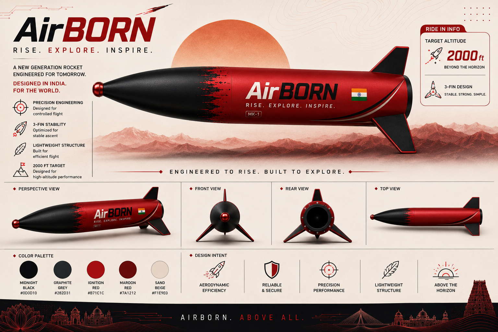

# 🚀 AirBORN — Suborbital Student Sounding Rocket

<div align="center">

[](https://air-born.vercel.app/)
[-0D0D10?style=for-the-badge)](https://air-born.vercel.app/)
[-7A1212?style=for-the-badge)](https://air-born.vercel.app/)
[](https://air-born.vercel.app/)
[](https://air-born.vercel.app/)

<p align="center">
  <b>AirBORN MK-1</b> is an indigenous high-power sounding rocket platform engineered in India by student rocketry innovators. Designed for suborbital low-altitude atmospheric research, active telemetry acquisition, and reliable dual-stage parachute recovery.
</p>

[**🌐 Live Platform & Telemetry**](https://air-born.vercel.app/) • [**📊 View Flight Gallery & Schematics**](https://air-born.vercel.app/gallery.html)

---



</div>

---

## 📋 1. Project Overview & Architecture

* **Vehicle Name:** AirBORN MK-1
* **Project Tier:** High-Power Student Sounding Rocket (Class G Motor Tier)
* **Primary Objective:** Deliver a stabilized ballistic flight trajectory to an apogee of **625 m (~2,050 ft)**, logging 6-DOF telemetry data and validating in-flight dynamic stability.
* **Secondary Objective:** Execute low-shock apogee parachute ejection with a touchdown descent velocity below **6.8 m/s**.
* **Simulation & Trajectory Modeling:** OpenRocket Aerodynamic Engine & KiCad Avionics.

---

## 📐 2. Airframe & Geometric Specifications

| Parameter | Specification | Engineering Rationale |
| :--- | :--- | :--- |
| **Total Length** | 62.0 cm | Optimizes fin-to-nose moment arm for caliber stability |
| **Airframe Outer Diameter (OD)** | 7.0 cm (2.75 in) | Low frontal cross-sectional area minimizing skin drag |
| **Airframe Inner Diameter (ID)** | 6.8 cm | 1.0 mm structural wall thickness |
| **Dry Mass (No Motor)** | 336 g | Includes potted tip ballast and internal bulkheads |
| **Liftoff Mass (Wet)** | ~461 g | Balanced for target thrust-to-weight ratio > 17:1 |
| **Center of Gravity (CG)** | 34.6 cm – 39.5 cm from nose tip | Maintains forward static margin across burnout |
| **Center of Pressure (CP)** | 42.8 cm from nose tip | Calculated via Barrowman aerodynamic equations |
| **Caliber Stability Margin** | **1.14 cal – 1.44 cal** | Optimal stability band avoiding weathercocking |

---

## ⚙️ 3. Subsystem Breakdown

### 🎯 3.1 Aerodynamic Nose Cone
* **Profile:** Tangent Ogive geometry with optimal fineness ratio.
* **Base Diameter:** 7.0 cm.
* **Fabrication:** 3D printed PETG / composite shell with high-temperature resin barrier.
* **Ballast Integration:** 40 g to 60 g lead-shot encapsulated in slow-cure 2-part epoxy resin at the extreme tip to anchor aerodynamic stability across supersonic transient conditions.

### 🛡️ 3.2 Airframe & Fuselage
* **Geometry:** OD 7.0 cm, ID 6.8 cm, Length 39.5 cm.
* **Material:** Multi-ply reinforced composite body tube.
* **Surface Finish:** Fine-sanded 60 µm aerodynamic polyurethane clear coat to minimize parasitic drag.

### 📐 3.3 Planar Fin System
* **Configuration:** Symmetrical 3-fin planar array (120° radial spacing).
* **Profile:** Trapezoidal with rounded leading edges and tapered trailing edges.
* **Root Chord:** 12.0 cm | **Tip Chord:** 5.0 cm | **Span:** 7.0 cm
* **Sweep Angle:** 19.7° (5.0 cm sweep length).
* **Material:** 3.0 mm Aircraft-grade Birch Plywood (density = 0.63 g/cm³) with structural epoxy root fillets.

### ⚡ 3.4 Avionics & E-Match Igniter
* **Schematic:** Custom KiCad-designed dual-stage MOSFET ignition circuit.
* **Igniter:** Pyrotechnic electric match with nichrome core and low-activation threshold.
* **Flight Computer:** Altimeter-triggered deployment bay with independent battery bus.

### 🪂 3.5 Recovery System
* **Canopy:** 45 cm diameter hemispherical ripstop nylon chute ($67\text{ g/m}^2$, $C_d = 0.800$).
* **Shock Harness:** 300 lb braided tubular Kevlar anchored into the motor mount forward centering ring.
* **Thermal Barrier:** Nomex reusable flame-retardant heat shield.

---

## 🚀 4. Propulsion & Simulated Trajectory Analysis

> **Reference Motor Specification:** Custom Sugar Propellant (KNSB / KNSU G-Class, 38 mm Casing)

```
       [ Ignition: 0.0s ] ─────────► [ Liftoff: 0.2s ]
                                           │
  [ Apogee: 625 m (~6.7s) ] ◄─── [ Coast: 1.8s - 6.7s ] ◄─── [ Burnout: 1.8s (175 m/s) ]
            │
  [ Ejection Charge Fires ] ────► [ Descent: 6.8 m/s ] ────► [ Safe Touchdown ]
```

| Trajectory Parameter | Simulated Metric |
| :--- | :--- |
| **Propellant Grain** | 125 g ($65:35\ \text{KNO}_3 : \text{Sorbitol/Dextrose}$) |
| **Total Impulse ($I_{\text{tot}}$)** | **~140 N·s** |
| **Average Thrust** | ~78 N (Peak: ~135 N) |
| **Burn Time** | ~1.8 s |
| **Peak Altitude (Apogee)** | **625 m (2,050 ft)** |
| **Maximum Velocity** | **175 m/s (Mach 0.51 / 630 km/h)** |
| **Maximum Acceleration** | **135 m/s² (13.8 g)** |
| **Time to Apogee** | 6.7 s |
| **Touchdown Velocity** | 6.8 m/s |

---

## 🛠️ 5. Fabrication & Safety Standards

1. **Fin Grain Orientation:** Cut fin cores parallel to the diagonal leading edge to eliminate aerodynamic flutter under maximum dynamic pressure ($q_{\text{max}}$).
2. **Epoxy Structural Fillets:** Dual-pass epoxy filleting with microballoon thickening along the root joint.
3. **Ballast Immobilization:** Ensure zero internal ballast clearance to avoid sudden CG shifts under 13.8 g longitudinal acceleration.
4. **Safety Protocol:** Adhere strictly to the Tripoli Rocketry Association (TRA) and National Association of Rocketry (NAR) Safety Codes during all propellant handling and static bench firings.

---

<div align="center">
  
  <p><b>AirBORN Aerospace Engineering</b><br/>Designed and Fabricated in India.<br/>
  📬 <b>Contact:</b> <a href="mailto:airbornrising@gmail.com">airbornrising@gmail.com</a>
  </p>
</div>
